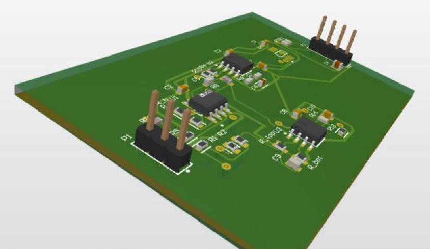
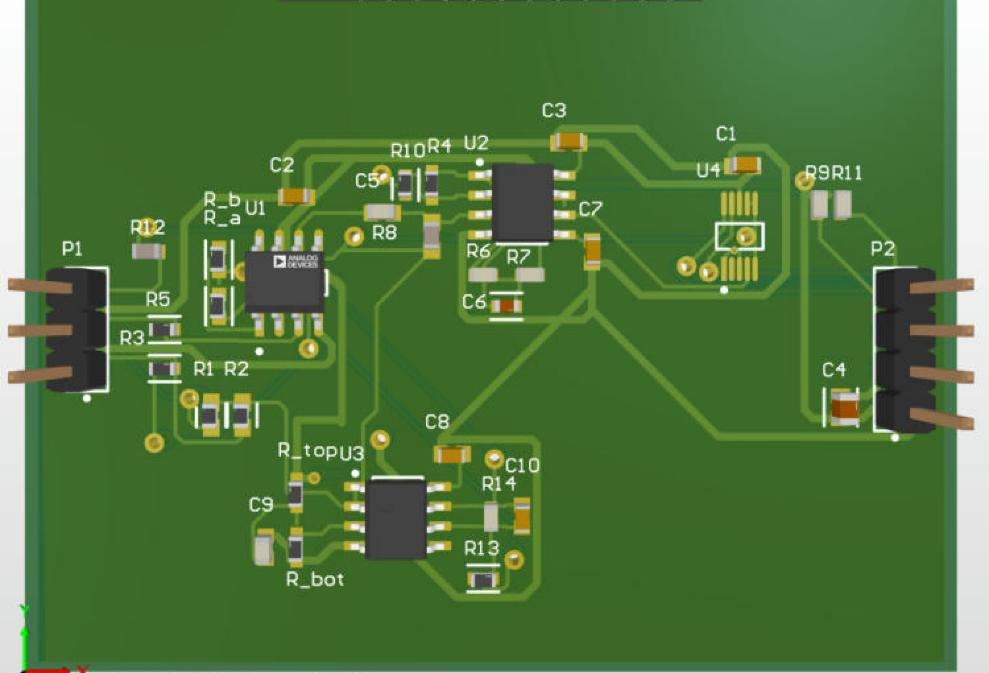
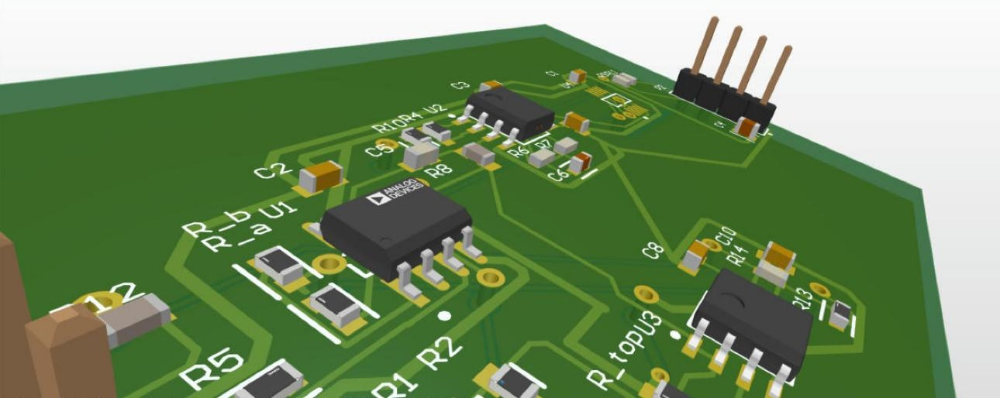
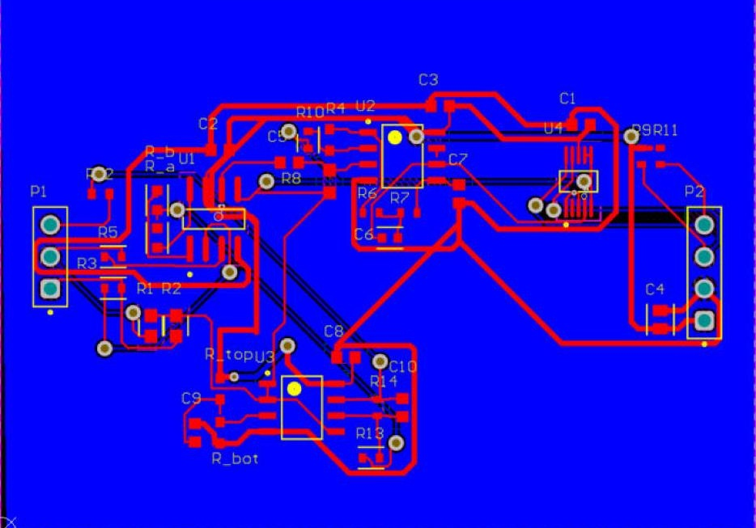
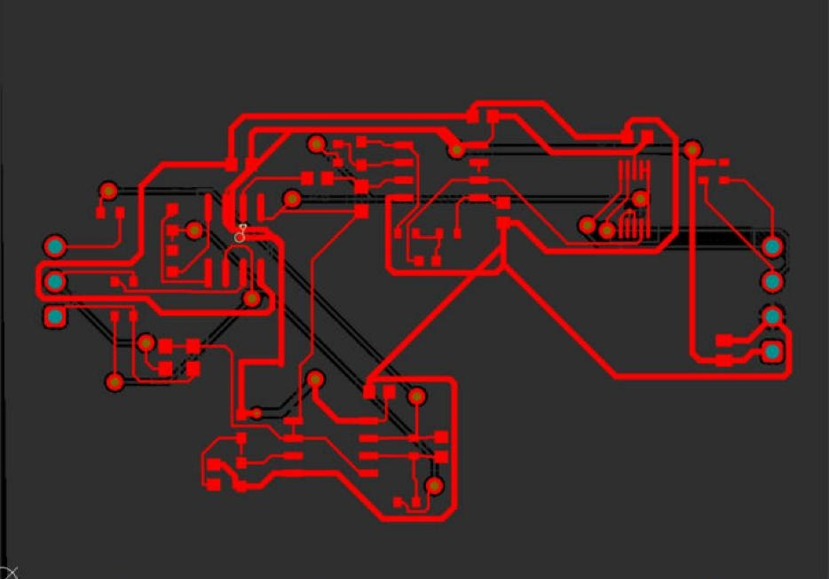
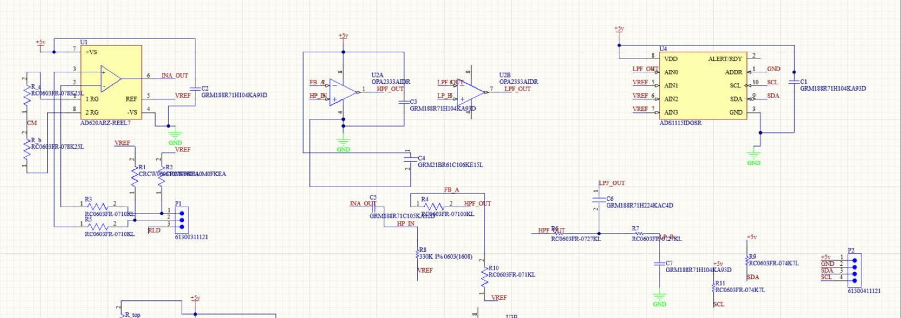
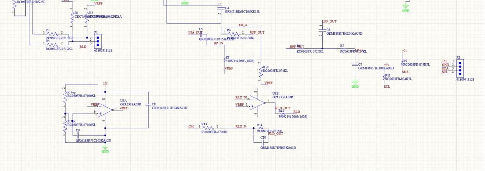

# ECG Analog Front-End PCB

2-layer ECG analog front end designed in **Altium Designer**. It amplifies and filters a ~1 mV electrode signal, digitizes it with a 16-bit ADC, and sends samples to an Arduino over I²C. Single 5 V supply.

*Design-only portfolio project. Not fabricated, but laid out and DRC-checked as if it would be.*



## Signal chain

```
Electrodes (RA, LA, RL)
  → 10 kΩ input protection + 10 MΩ bias to 2.5 V
  → AD620 instrumentation amp (G ≈ 4)
  → OPA2333 high-pass 0.48 Hz + gain of 101
  → OPA2333 Sallen-Key low-pass 39.7 Hz (Q = 0.74)
  → ADS1115 16-bit ADC → I²C → Arduino
```

**Helper circuits**

- **2.5 V reference:** 100k/100k divider buffered by an OPA2333. The whole analog side is centered on this mid-supply voltage.
- **Right-leg drive:** inverts the common-mode signal (gain 50, 16 Hz pole) and feeds it back to the RL electrode to cancel 60 Hz hum. 390 kΩ limits the current to under 13 µA.

**Total gain ≈ 403**, so a 1 mV ECG becomes about 0.4 V at the ADC (±2.048 V range, 0.16 µV per LSB referred to the input).

## Key design decisions

- **Low first-stage gain (G ≈ 4).** Electrodes can carry up to ±300 mV of DC offset. A higher AD620 gain would saturate before the high-pass filter removes it.
- **OPA2134 replaced with OPA2333.** The OPA2134's input common-mode range is empty on a single 0–5 V supply. The OPA2333 has the same pinout, rail-to-rail I/O, runs on 1.8–5.5 V, and has lower noise at ECG frequencies.
- **Split gain resistor (2 × 8.25 kΩ).** The midpoint gives the common-mode voltage for the right-leg drive.

## PCB layout

| | |
|---|---|
|  |  |
| 3D top view | Close-up: AD620 and OPA2333s |
|  |  |
| All layers | Top copper only |

- 60 × 45 mm, 2 layers, 1.6 mm FR-4
- Solid GND pour on the bottom layer
- 0.1 µF decoupling at every IC power pin, 10 µF bulk at the Arduino header
- 0.5 mm power traces, 0.254 mm signal traces, necked down at the 0.5 mm-pitch ADS1115
- **DRC: 0 electrical errors** (no shorts, clearance violations or unrouted nets)
- Mostly autorouted; decoupling and fine-pitch ADS1115 connections routed by hand

## Schematic




Full schematic and layout: [ECG_FrontEnd.pdf](ECG_FrontEnd.pdf)

## Main parts

| Ref | Part | Package | Role |
|---|---|---|---|
| U1 | AD620ARZ | SOIC-8 | Instrumentation amplifier |
| U2 | OPA2333AIDR | SOIC-8 | High-pass + gain, low-pass |
| U3 | OPA2333AIDR | SOIC-8 | 2.5 V reference, right-leg drive |
| U4 | ADS1115IDGSR | VSSOP-10 | 16-bit ADC, I²C address 0x48 |
| P1 | 3-pin header | 2.54 mm | Electrodes (RA, LA, RL) |
| P2 | 4-pin header | 2.54 mm | Arduino (5 V, GND, SDA, SCL) |

## Files

- `ECG_FrontEnd.PrjPcb`: Altium project
- `ECG_FrontEnd.SchDoc`: schematic
- `ECG_FrontEnd.PcbDoc`: PCB layout
- `ECG_FrontEnd.pdf`: schematic and layout as a PDF

## Next steps

- Hand-route the analog signal path for shorter, cleaner traces
- Pull the GND pour back 0.5 mm from the board edge
- Generate Gerbers if the board is ever fabricated
